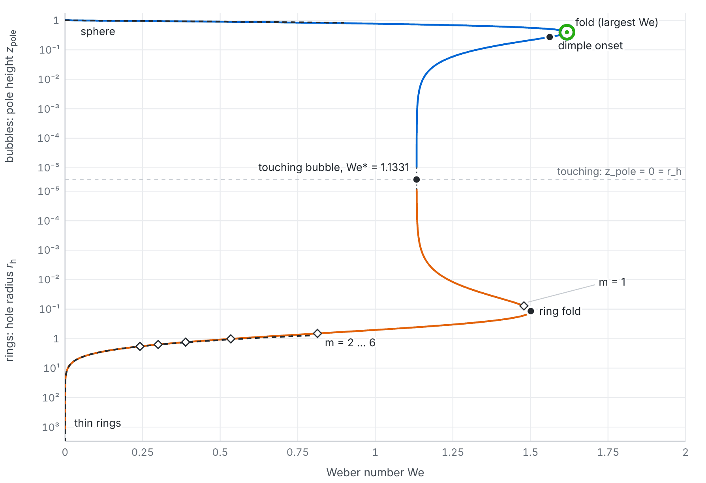

# Axisymmetric bubbles

Steady axisymmetric bubbles in an inviscid stream, computed from the sphere to thin bubble rings.

A bubble filled with vacuum moves at constant speed through an inviscid, incompressible fluid at
rest at infinity; the flow outside is irrotational, and surface tension balances the pressure at
the interface. After scaling, a single parameter remains, the Weber number We. This repository
continues two families of solutions that were constructed rigorously, each in its own limit, and
finds that they lie on one connected curve:

* the near-spherical bubbles of D. Meyer, L. Niebel and C. Seis, *Steady bubbles and drops in
  inviscid fluids*, Calc. Var. PDE (2025), [arXiv:2503.05503](https://arxiv.org/abs/2503.05503);
* the thin hollow vortex rings with surface tension of D. Meyer and C. Seis, *Steady ring-shaped
  vortex sheets*, J. Eur. Math. Soc. (2026), [arXiv:2409.08220](https://arxiv.org/abs/2409.08220).

The page **[steady-bubbles.github.io/axisymmetric](https://steady-bubbles.github.io/axisymmetric/)**
shows the result: the bifurcation diagram, every computed state with its flow, and the comparison
with both theories. This repository holds the solver, the scripts that ran every computation, the
data, and the code that builds the page.



## Results

* **Bubbles.** From the sphere (We = 0) the bubbles flatten, pass a largest Weber number
  **We_max = 1.617652171892** (13 digits; an independent solver in 80-bit arithmetic gives the
  same), develop dimples at the poles from We = 1.562047 (λ = 0), stop being star-shaped at
  We = 1.230744, and end when the two poles touch, at **We\* = 1.133089514170**.
* **Bubble rings.** The zero-flux rings (no net flux through the hole) start from the same touching
  bubble. Their Weber number has a largest value at hole radius r_h = 0.1162, We = 1.50120, and as
  the hole opens they become thin rings; the computed branch runs to r_h ≈ 1200.
* **Where they meet.** Bubbles approach the touching bubble along We − We\* ≈ 2.0364 z_pole, rings
  along We − We\* ≈ 2.0364 r_h log(1/r_h); the ring coefficient equals the bubble slope to 3·10⁻⁷.
* **Near the sphere.** The aspect ratio is χ = 1 + 0.2812499999985 We + …, against 9/32 from
  Meyer–Niebel–Seis, and λ = 2 − 0.7499999999986 We + …, against 3/4.
* **Thin rings.** Speed, flux constant and Bernoulli constant match Theorem 1.3 of Meyer–Seis; the
  differences fall like ε² log²(1/ε) in the aspect ratio ε of the tube, to 10⁻⁷ at ring radius
  R ≈ 320 (and to 2·10⁻⁹ at R = 1199 for the Bernoulli constant).
* **Bifurcations.** Within the axisymmetric class the second variation changes sign only at the two
  folds, so no other axisymmetric branch leaves this one. Non-axisymmetric branches leave the rings:
  an off-centre hole (azimuthal wave number m = 1) at r_h = 0.0777, and beaded rings with
  m = 2, …, 6 at r_h = 0.667, 1.017, 1.313, 1.579 and 1.825.

That the two families are connected is observed numerically; to prove it remains open. More
numbers, with how each was checked, are in [docs/numerics.md](docs/numerics.md).

## Contents

| path | what |
|---|---|
| `bubbles/` | the solver: boundary integral equations on Chebyshev panels, the bubble and ring states, Newton's method, continuation, and the second-variation spectra |
| `scripts/` | the computations (table below) |
| `checks/` | the comparisons with Meyer–Niebel–Seis (`check_mns.py`) and Meyer–Seis (`check_ms.py`) |
| `verify/` | independent checks: a second bubble solver in 80-bit arithmetic (`independent_bubble.py`), a second ring solver, flow-field and Biot–Savart checks (see `verify/README.md`) |
| `tests/` | unit tests of the solver |
| `results/` | the computed data (table below) |
| `page/` | the page: template, text, references, and the scripts that build it, `docs/numerics.md` and `docs/page_text.tex` |
| `docs/` | `numerics.md` (precision and checks in detail), `page_text.tex` (all prose of the page, for editing), the figure above |

## Running it

```
pip install -e ".[test]"
python -m pytest                       # the solver's tests, about 3 min
python page/build_page.py              # the page, from results/, into build/index.html (seconds)
```

The published page is a copy of `build/index.html` in
[steady-bubbles/steady-bubbles.github.io](https://github.com/steady-bubbles/steady-bubbles.github.io)
(`axisymmetric/index.html`). `python page/write_numerics.py` and `python page/export_text.py`
regenerate `docs/numerics.md` and `docs/page_text.tex`.

The checks: `python checks/check_ms.py` (about 1 min), `python checks/check_mns.py` (about 5 min on
4 cores), `python verify/independent_bubble.py` (see its docstring).

### Rerunning the computations

Times are for 4 cores unless stated. `BUBBLES_NPROC` sets the number of worker processes.

**High-resolution computation** (`results/hires/`; the page shows this):

| step | command | time |
|---|---|---|
| bubble branch, 549 states from the sphere to z_pole = 10⁻⁵ | `python scripts/run_branch_hires.py results/hires/branch.json` | 1.5 h (1 core) |
| ring chains (table in the script's docstring) | `python scripts/hires_rings.py results/hires/rings` | 0.3–2 h per chain |
| merged ring branch, 254 rings | `python scripts/merge_hires_rings.py --report` | seconds |
| bubble frames for the page | `python scripts/export_viz.py results/hires/branch.json results/hires/viz/bubble_viz.json 4 --step=2` | 10–30 min |
| ring frames for the page | `python scripts/export_rings_viz.py results/hires/rings_merged.json results/hires/viz/rings_viz.json --sheets=none` | 1–2 h |
| asymptotics at the touching bubble | `python scripts/ring_asymptotics.py results/hires/rings_merged.json --rh-max=0.0393 --branch=results/hires/branch.json --outdir=results/hires/asymptotics` | minutes |

**First computation** (`results/`, `results/rings/`; lower resolution, used for the stability
analysis, the branch points, the flux scans and the precision studies, and as starting rings):

| step | command | time |
|---|---|---|
| bubble branch | `python scripts/run_branch.py results/branch.json 1e-5 0.05 0.125` | 8 min (1 core) |
| fold, dimple onset, loss of star-shapedness | `python scripts/special_points.py` | about 1 h (1 core) |
| convergence in the resolution | `python scripts/convergence.py` | 5 min |
| bubble spectra | `python scripts/bubble_sectors.py results/bubble_sectors_all.json --every=1 --m=0,1` | 10 min (1 core) |
| ring spectra | `python scripts/ring_sectors.py results/rings/ring_sectors_all.json results/rings/rings_{neck3,neck2,neck,down2,down,up,thin,thin2,thin3,thin7}.json --sectors=0o,0eQ,0eG,1e,1o --bounds --nev=4` | 25 min (1 core) |
| non-axisymmetric branch points | `python scripts/crossing_rings.py --m=2,3,4,5,6`, then `--m=1 --dQ=2e-4` | 40 min |
| flux scans at fixed hole radius | `python scripts/ring_qscan.py results/rings/rings_up.json 4 results/rings/sheet_rh0.069.json --M=64 ...` (each scan's options are in its `.meta.json`) | 1–2 h each |
| resolution of the rings | `python scripts/compare_precision.py`; `python scripts/ring_convergence.py ...` | 1 min; 3 h |
| zero-flux rings | `python scripts/run_rings.py start out.json factor r_stop [M_max] [--neck] [--thin]` | 10 min – 4 h per run |

## Data

All files are JSON unless noted; each script's docstring describes its output.

| file | contents |
|---|---|
| `results/hires/branch.json` | 549 bubble states from the sphere to touching: shape coefficients, panels, We, λ and diagnostics (`*.log`: the run) |
| `results/hires/rings/` | the ring chains: `<chain>0_p<k>.json` (rings), `*_last.npz` (restart states), `*.log` |
| `results/hires/rings_merged.json` | the zero-flux ring branch, 254 rings; `source` names the chain of each |
| `results/hires/viz/` | the page's frames: shapes, surface speed, streamlines |
| `results/hires/asymptotics/` | the touching asymptotics (`asymptotics.md`) |
| `results/branch.json`, `results/rings/rings_*.json` | the first computation's bubbles and rings |
| `results/special_points.json`, `results/convergence.json` | fold, dimple onset and loss of star-shapedness at three resolutions; resolution study |
| `results/bubble_sectors_all.json`, `results/rings/ring_sectors_all.json` | second-variation spectra along both branches |
| `results/rings/crossing_rings.json` | the rings where non-axisymmetric branches leave |
| `results/rings/sheet_rh*.json` | flux scans: rings with flux through the hole at eight hole radii |
| `results/rings/precision.json`, `results/rings/ring_convergence_thin.json` | resolution studies of the rings |
| `results/checks/` | the outputs of `checks/` and `verify/independent_bubble.py` |
| `results/verify/` | the outputs of the other `verify/` scripts |

## Resolution and provenance

In the high-resolution computation the bubbles are resolved to a truncation indicator below
10⁻¹² and the rings to a Fourier tail below 10⁻¹³ (the first computation used a tail of 10⁻¹² for
rings with small holes and a residual indicator elsewhere, with 128 to 320 Fourier modes). Two parameter maps are used
for the rings: one adapted to the curvature, and one to the catenoidal neck of rings with small
holes; where both resolve a ring they agree to 5·10⁻¹³.

* The touch chain stopped at r_h = 1.0·10⁻⁵ (its next step did not finish the mode refinement in
  two hours), so the smallest ring of the merged branch, r_h = 8.6·10⁻⁶, comes from the first
  computation.
* Beyond r_h ≈ 130 the residual can only be driven to its round-off floor 3·10⁻¹⁵ r_o², which
  leaves a scatter of a few 10⁻⁹ in the Weber numbers of the thinnest rings.
* For several runs of the first computation (`results/rings/rings_*.json`) the exact command
  lines were not recorded; their logs give the starting ring, and the files record the
  resolution of every ring. `rings_thin7.json` starts from a ring at r_h = 336 that is not kept.

## Author

[Lukas Niebel](https://lukasniebel.github.io), with the help of Claude Opus.
